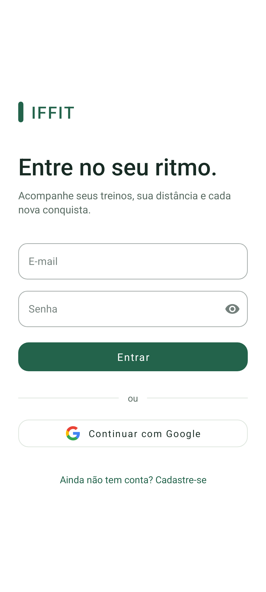
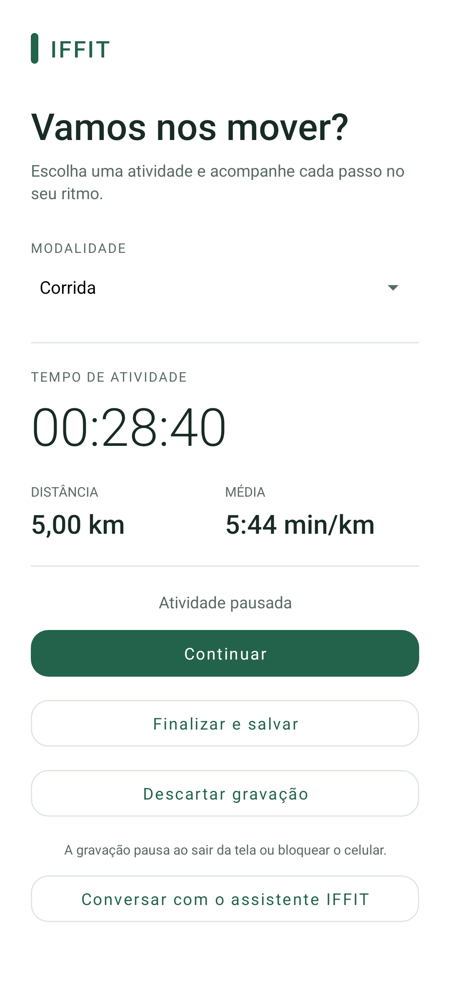
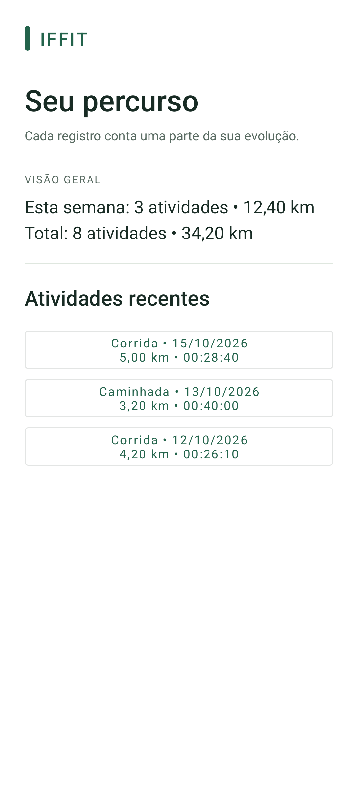
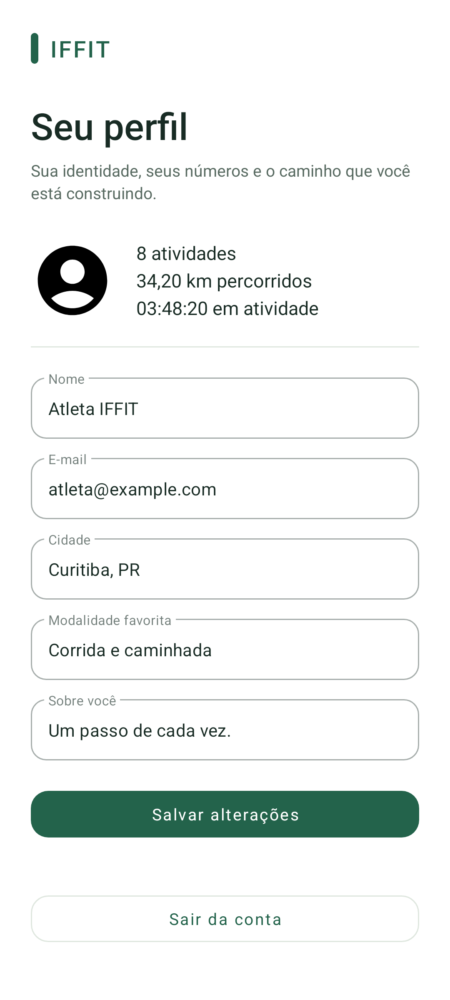

<p align="center">
  
</p>

# IFFIT

Aplicativo Android para registrar corridas, caminhadas e pedaladas, acompanhar o histórico e consultar a própria evolução.

## Sobre o projeto

Este projeto foi desenvolvido originalmente como uma atividade acadêmica no Instituto Federal do Paraná (IFPR). Durante a atividade, diferentes recursos do desenvolvimento Android foram implementados em etapas e organizados em branches, incluindo autenticação, cadastro de dados, localização, inteligência artificial e notificações.

Na versão acadêmica, essas funcionalidades funcionavam como exercícios independentes e ainda não formavam uma proposta única de aplicativo. A localização já era utilizada para acompanhar corridas, enquanto outros módulos exploravam cadastro de produtos e acompanhamento de entregas.

Posteriormente, o repositório foi reestruturado e recebeu pequenas alterações de organização, interface e funcionamento. O acompanhamento de atividades físicas passou a ser o foco do aplicativo; os módulos que não combinavam com essa proposta foram retirados, e os recursos existentes foram reunidos sob a identidade **IFFIT**.

O nome IFFIT combina a referência ao Instituto Federal do Paraná com o termo *fitness*. Este é um projeto pessoal, sem vínculo oficial com o IFPR.

## Telas

<p align="center">
  
  
  
  
</p>

Layouts reais renderizados no emulador com dados demonstrativos. Nenhum dado de conta pessoal aparece nas imagens.

## O que o app faz

- **Acesso:** cadastro, login por e-mail/senha ou Google e retorno automático para quem já está conectado.
- **Atividades:** corrida, caminhada e ciclismo; iniciar, pausar, continuar, salvar e descartar.
- **Métricas:** tempo de atividade, distância, ritmo médio e velocidade média para ciclismo.
- **Histórico:** registros por usuário, detalhes, totais e resumo semanal.
- **Perfil:** nome, cidade, modalidade favorita, biografia e estatísticas.
- **Marcos pessoais:** quantidade de atividades, distância acumulada e maior distância registrada.
- **Assistente:** perguntas em texto com imagem opcional, usando Firebase AI Logic.
- **Notificações:** recebimento de mensagens pelo Firebase Cloud Messaging e configuração da permissão.

## Como funciona a gravação

A localização precisa do dispositivo é usada para estimar a distância. O app filtra posições antigas, pouco precisas e deslocamentos incompatíveis, mas o resultado ainda depende da qualidade do GPS.

A tela permanece acesa durante a atividade. **Ao trocar de tela, bloquear o aparelho ou deixar o app em segundo plano, a gravação pausa.** Para retomá-la, volte ao Início e toque em Continuar. O tempo pausado não entra no registro.

É possível salvar uma atividade com pelo menos um segundo e 0 km. Nesse caso, o app avisa que não houve distância registrada; o ritmo fica indisponível. O salvamento usa um identificador estável para evitar duplicação em uma nova tentativa.

Aguarde a confirmação do Firebase antes de encerrar o app. Sem rede, o salvamento pode ficar pendente. Atividades ainda não salvas não têm recuperação garantida após encerramento forçado.

## Executar

### Requisitos

- Android Studio e Android SDK 35.
- JDK 17 ou 21 configurado como **Gradle JDK**; a versão foi validada com JDK 21.
- Emulador com Google Play Services ou celular com Android 7.0/API 24 ou superior.
- Projeto Firebase configurado e conexão à internet.

Também é possível editar no VS Code e compilar pelo terminal, com JDK e SDK configurados.

### 1. Abrir o projeto

```bash
git clone https://github.com/gustavokkj/iffit-android.git
cd iffit-android
```

Abra a pasta no Android Studio. O arquivo `local.properties`, com o caminho do SDK, é específico da máquina e não é versionado.

### 2. Configurar o Firebase

1. Registre um app Android com o package `com.ifpr.androidapptemplate`.
2. Baixe a configuração e coloque em **`app/google-services.json`**.
3. Habilite Authentication com e-mail/senha. Para Google, habilite o provedor e cadastre SHA-1/SHA-256.
4. Crie o **Realtime Database** e revise/publice as regras de acesso.
5. Para o assistente, configure Firebase AI Logic com Gemini Developer API.
6. Para notificações, configure o envio pelo Cloud Messaging.

O arquivo `google-services.json` está ignorado pelo Git. O package original foi mantido para preservar a compatibilidade com o Firebase e instalações existentes.

As regras de exemplo estão em [firebase/database.rules.example.json](firebase/database.rules.example.json). Elas restringem os dados ao usuário autenticado e validam os campos das atividades. A publicação no console é manual; os testes locais não mudam seu banco.

**Se a atividade não salvar:** confira no Firebase Console → Realtime Database → Regras se há permissão para `atividades/{uid}`. Regras temporárias expiradas, validação exigindo distância positiva ou ausência desse caminho podem recusar o registro. Não deixe o banco público para contornar o erro.

O modelo da IA é configurado pelo recurso `ai_model` em `strings.xml`. Consulte os [modelos disponíveis no Firebase](https://firebase.google.com/docs/ai-logic/models). Perguntas e imagens selecionadas são enviadas ao serviço; o histórico de atividades não é enviado automaticamente.

### 3. Rodar

Aguarde o Gradle Sync, selecione um dispositivo e execute `app`.

No Windows:

```powershell
.\gradlew.bat assembleDebug
```

No Linux/macOS:

```bash
./gradlew assembleDebug
```

APK de desenvolvimento: `app/build/outputs/apk/debug/app-debug.apk`. Ele não é uma versão assinada para publicação na Play Store.

## Tecnologias e estrutura

Kotlin, XML, View Binding, Navigation Component, ViewModel/SavedStateHandle, Coroutines, Material Components, Glide e Google Play Services Location.

Firebase Authentication, Realtime Database, Cloud Messaging e AI Logic.

| Configuração | Valor |
| --- | --- |
| Versão IFFIT | 0.1.0 (`versionCode = 2`) |
| Android mínimo | API 24 |
| compileSdk / targetSdk | 35 |
| Android Gradle Plugin / Gradle | 8.10.0 / 8.11.1 |
| Bytecode Java/Kotlin | 11 |
| applicationId | `com.ifpr.androidapptemplate` |

O bytecode 11 não significa que o Gradle deva ser executado com JDK 11.

```text
app/src/main/
├── java/com/ifpr/androidapptemplate/
│   ├── baseclasses/          # Atividade e formatação das métricas
│   ├── data/                 # Acesso às atividades no Firebase
│   └── ui/
│       ├── home/             # Registro e estado da atividade
│       ├── dashboard/        # Histórico e detalhes
│       ├── usuario/          # Cadastro e perfil
│       ├── login/            # Autenticação
│       ├── notifications/    # Marcos pessoais e permissões
│       ├── firebase/         # Recebimento de push
│       └── ai/               # Assistente esportivo
└── res/                      # Layouts, textos, tema e ícones
firebase/                     # Regras e testes com emulador local
docs/                         # Imagens e roteiro de verificação
```

As telas usam Activities e Fragments. O registro mantém o estado em um ViewModel; um repositório concentra leitura e gravação das atividades. Textos da interface estão organizados em recursos Android.

## Dados armazenados

```text
users/{uid}/
  key, nome, email, cidade, modalidadeFavorita, bio

atividades/{uid}/{id}/
  id, usuarioId, modalidade, inicio, duracaoSegundos, distanciaMetros
```

O início é armazenado em milissegundos desde Unix epoch, a duração em segundos e a distância em metros. As coordenadas e o trajeto completo não são persistidos.

O perfil atualiza apenas os campos necessários, preservando dados antigos. A limpeza do código de produtos e entregas não apaga os dados da versão acadêmica no Firebase.

## Testes

```powershell
.\gradlew.bat assembleDebug testDebugUnitTest lintDebug
.\gradlew.bat connectedDebugAndroidTest
```

O segundo comando exige um dispositivo conectado. Há testes de métricas, validação da atividade, preservação do estado e abertura dos layouts.

Para testar as regras do banco com contas fictícias, use Node.js 22/24 e Java 21:

```powershell
cd firebase
npm ci
npm test
```

Os testes rodam no projeto local `demo-iffit`, sem gravar no Firebase real. O [roteiro de verificação](docs/TESTING.md) detalha a cobertura, os comandos de geração das imagens e os testes manuais.

## Limitações atuais

- Sem mapa, rota persistida ou rastreamento em segundo plano.
- Sem feed social, seguidores, ranking ou metas configuráveis.
- Sem edição/exclusão de atividades pela interface e sem paginação do histórico.
- Sem lembretes automáticos, caixa de entrada de notificações ou servidor para gerenciar tokens de push.
- Assistente sem histórico de conversa e sem acesso automático aos treinos.
- Login Google ainda utiliza as APIs herdadas do projeto acadêmico.
- Interface clara; não há tema escuro próprio.
- GPS em celular físico e integrações de Google, IA e push ainda exigem validação no ambiente configurado.

## Histórico e branches

- `main`: versão atual do IFFIT.
- `feature_fitness`: branch usada na reestruturação.
- `feature_notif`: referência da versão acadêmica.
- `v0.1.0`: primeira versão organizada como IFFIT.

Veja as mudanças em [CHANGELOG.md](CHANGELOG.md). As demais branches registram etapas anteriores do desenvolvimento.

## Licença

[Apache License 2.0](LICENSE).
